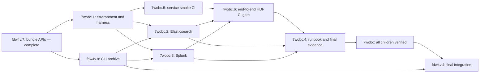

# Local SIEM integration verification

Status: implementation in progress. The shared environment runner and helper tests exist; Elasticsearch and Splunk passed combined authenticated readiness, license checks and cleanup. The owner approved Splunk's runtime terms and local AMD64 emulation. Current CLI and packed TypeScript artifacts passed verification; CLI evidence-package delivery/recovery passes focused tests and built-binary checks, and independent re-review marked its implementation findings addressed; the combined publication tree clears the prior comparison-schema failures; final integration acceptance remains open. Elasticsearch ingestion/readback acceptance is complete. Splunk local ingestion/readback passed the full CLI and packed TypeScript matrix (16 cases, 3,224 events), including the add-on repair for duplicate scalar values and multiline titles; Beads records independent acceptance. Hosted full end-to-end CI passed for both targets, including the aggregate JUnit/HDF gate and controlled failure probes. Final integration handoff remains open. The environment card is closed after independent review. This work ships with the current validator/source-preservation PR. Beads owns execution status; this file records the design, responsibilities, and acceptance contract.

Schema compatibility is verified by the [isolated schema integration plan](SCHEMA-INTEGRATION-PLAN.md), tracked in sub-epic `hdf-libs-fdw4v.9`. Combined-checkout results do not waive verification on the eventual delivery tree.

This implements [ADR-0019](dev-docs/adr-0019-siem-source-preservation.md) preservation and live-verification requirements with the delivery contract in [ADR-0020](dev-docs/adr-0020-siem-evidence-package-delivery.md). ADR-0020 supersedes the standalone three-file delivery recommendation. It preserves the accepted `legacy-additive/1` profile, existing exporter defaults, and the requirement for actual Elasticsearch and Splunk verification before integration closes.

## Outcome and boundaries

A contributor can start isolated test services, build the current CLI and locally packed TypeScript library, ingest their real fixture exports, query findings, retrieve preserved records, verify retained artifacts, and remove only the resources created by that run. The same harness is reusable when HDF schemas or exporters evolve.

Owner decision (2026-11-07): adopt Testcontainers Node as the development-only test lifecycle manager, using `DockerComposeEnvironment` with the shared Compose definition. Use Docker Compose with one Elasticsearch node and one standalone Splunk instance with HTTP Event Collector. Separate service profiles allow running either target alone. Kubernetes adds orchestration that these product-contract tests do not exercise; a cluster deployment, dashboards, and production sizing are outside this PR. OCSF continues to receive schema, CLI, and Go/TypeScript parity verification; this plan does not invent an OCSF ingestion service.

The harness is development-only. It adds no SIEM client SDK, container library, or service dependency to published HDF packages. The owner approved GitHub Actions verification in this PR after reviewing the CI research. Local and hosted execution reuse the same harness without silently accepting vendor terms or making ordinary unit tests require containers.

## Prior art and runtime qualification

Checked through official repositories with `gh` on 2026-11-07. Versions below identify inspected upstream releases, not verified container digests or a promise that every platform image exists.

| Candidate | Inspected version and license | Decision |
|---|---|---|
| [Docker Compose](https://github.com/docker/compose/tree/v5.7.0) | v5.7.0; repository LICENSE is Apache-2.0 | ADOPT the existing Compose CLI and service definition underneath Testcontainers; no bespoke container orchestrator or automatic CLI upgrade |
| [Elasticsearch](https://github.com/elastic/elasticsearch/tree/v9.5.6) | v9.5.6; LICENSE.txt describes AGPL-3.0-only/SSPL-1.0/Elastic License 2.0 choices for source, with some Elastic-License-only code | ADOPT an official distribution as an external test target, subject to its actual distribution terms; do not vendor source or treat it as an Apache-licensed library dependency |
| [Docker-Splunk](https://github.com/splunk/docker-splunk/tree/10.6.1.1) | 10.6.1.1; docs/LICENSE.md is Apache-2.0 for tooling; README separately subjects container software to Splunk General Terms | REFERENCE official standalone/HEC setup and ADOPT the vendor runtime as an external test target after terms and image qualification; tooling license does not license Splunk Enterprise |

| Upstream | Latest release published | Latest observed merged PR | Default-branch commit | Archived |
|---|---|---|---|---|
| docker/compose | 2026-11-02 | 2026-11-05 | 2026-11-05, `95bbca758244b94ec03a83911bb040a45b82e3fb` | no |
| elastic/elasticsearch | 2026-11-02 | 2026-11-07 | 2026-11-07, `2092e4a3f20f0fd8f12d0bc0e396a1649fb9c7b1` | no |
| splunk/docker-splunk | 2026-10-27 | 2026-09-17 | 2026-09-17, `138dd708739b0956b6137f7f919f66583636fa13` | no |

All three have activity within six months. Health dates describe the latest release and most recent merged PR observed in the queried closed-PR sample; refresh them when implementation begins. Read licenses again if the chosen version changes. The repository's `.github/workflows/dependency-review.yml` denies AGPL and SSPL dependencies. This plan neither changes that policy nor adds those source packages to the library. Record the official image's terms, exact tag/digest, platform manifest, resource requirements, and owner's runtime-license decision before downloading or starting license-gated software. Never bake acceptance into a default environment file.

Official starting points: [Elasticsearch single-node Docker setup](https://www.elastic.co/docs/deploy-manage/deploy/self-managed/install-elasticsearch-docker-basic), [Splunk standalone and HEC examples](https://splunk.github.io/docker-splunk/EXAMPLES.html), and [Splunk trial licensing](https://help.splunk.com/en/splunk-enterprise/administer/admin-manual/10.6/start-splunk-enterprise-and-perform-initial-tasks/install-your-license). Trial expiry and daily ingestion limits must be detected and reported. Recreating containers to evade a license limit is not a test strategy.

## Reusable implementations inspected

Research on 2026-11-07 read the configuration and tests through `gh`, rather than relying on project descriptions. These are upstream examples, not a claim that this checkout has run them. Commit pins below identify the inspected source; image digests remain an environment-card qualification step.

| Project and inspected source | Decision and reusable part | Adaptation required here |
|---|---|---|
| [Splunk standalone HEC scenario](https://github.com/splunk/docker-splunk/blob/138dd708739b0956b6137f7f919f66583636fa13/test_scenarios/1so_hec.yaml), plus its [current README](https://github.com/splunk/docker-splunk/blob/138dd708739b0956b6137f7f919f66583636fa13/README.md) | ADAPT the official standalone service, HEC environment configuration, and management/search access. Tooling Apache-2.0; runtime terms remain separate. | The example defaults to `latest`, a fixed example token and debug output. It omits the additional `SPLUNK_GENERAL_TERMS` argument the README requires for 10.x. Pin the image, generate private credentials, restrict published interfaces, and supply required acceptance flags only following explicit runtime consent. |
| [Elastic start-local generator](https://github.com/elastic/start-local/blob/0a56d370042dc6d5032026b0173c93e94f2f1676/start-local.sh) | ADAPT its single-node service, authenticated readiness check, loopback binding and generated credentials. Apache-2.0. It already supports an Elasticsearch-only path. | Extract the small service definition; do not run the installer or adopt Kibana, EDOT, fixed container names, or version-specific JVM workarounds without need. Use Basic licensing rather than the generator's trial setting, subject to actual feature verification. Keep the existing TLS policy. |
| [OpenTelemetry Splunk HEC integration test](https://github.com/open-telemetry/opentelemetry-collector-contrib/blob/817fe19a61cf04b27fc7d1e9128fc1b3bea7d047/exporter/splunkhecexporter/integration_test.go) and [search helper](https://github.com/open-telemetry/opentelemetry-collector-contrib/blob/817fe19a61cf04b27fc7d1e9128fc1b3bea7d047/exporter/splunkhecexporter/internal/integrationtestutils/splunk.go) | ADAPT the demonstrated sequence: start real Splunk, ingest HEC, create a search job, poll completion, retrieve events and compare `_raw`. Apache-2.0. Its defaults YAML shows how to configure a test index. | Borrow the sequence, not the implementation wholesale: replace fixed sleeps and permissive timeout handling with deadline failures; validate HTTP responses and trust certificates. Do not inherit insecure TLS, automatic terms acceptance, or deletion of a shared image. HDF assertions must cover full preservation and numeric tokens, beyond the upstream string-event check. |
| [Testcontainers Node Elasticsearch module](https://github.com/testcontainers/testcontainers-node/blob/c79a5a56bcc824e207ac243207bd83e5b0459dd3/packages/modules/elasticsearch/src/elasticsearch-container.ts) and [Compose support](https://github.com/testcontainers/testcontainers-node/blob/c79a5a56bcc824e207ac243207bd83e5b0459dd3/docs/features/compose.md) | ADOPT `DockerComposeEnvironment` for startup, wait strategies, mapped endpoints, service selection and teardown. MIT. Owner approved adoption from the start. | Add `testcontainers` only to the private root development dependencies. Keep one Compose service definition; qualify the published package, helper images, runtime connectivity and cleanup before live acceptance. Do not independently manage the same containers through a second lifecycle path. |
| [docker-elk Compose stack](https://github.com/deviantony/docker-elk/blob/da954e8262f48ceef54f2547b44f4662d354e341/docker-compose.yml) | REFERENCE its one-time setup profile and service configuration. MIT tooling. | REJECT adopting the full stack for this task: Logstash, Kibana, custom builds and extra users do not exercise our direct export contract. Its published ports also need restriction for this plan. |

License files were read at the inspected commits: Splunk `docs/LICENSE.md`; the other four repositories' `LICENSE`. Apache-2.0 and MIT tooling are not on this repository's deny list. Product distribution licenses are separate, as described above. Preserve applicable copyright/license notices if implementation copies upstream code; this research copies no implementation.

| Additional upstream | Inspected commit | Latest release | Latest observed merged PR / default commit | Archived |
|---|---|---|---|---|
| elastic/start-local | `0a56d370042dc6d5032026b0173c93e94f2f1676` | 0.14.0, 2026-02-24 | 2026-06-23 / 2026-06-23 | no |
| open-telemetry/opentelemetry-collector-contrib | `817fe19a61cf04b27fc7d1e9128fc1b3bea7d047` | v0.165.0, 2026-11-07 | 2026-11-07 / 2026-11-07 | no |
| testcontainers/testcontainers-node | `c79a5a56bcc824e207ac243207bd83e5b0459dd3` | v12.2.1, 2026-10-13 | 2026-11-06 / 2026-11-06 | no |
| deviantony/docker-elk | `da954e8262f48ceef54f2547b44f4662d354e341` | 9.2511.1, 2025-11-06 | 2026-11-02 / 2026-11-02 | no |

All inspected projects have default-branch and merged-PR activity within six months. Release ages alone are not evidence that a project is abandoned. Splunk's source revision and health appear in the earlier matrix.

### What this changes in the implementation

Keep the two-service Compose design and use Testcontainers Node to run it. Compose owns images, configuration, health checks and networking; Testcontainers owns per-run project identity, service startup, bounded wait strategies, mapped endpoints and teardown. The Node runner remains a thin adapter for credentials, build/pack commands, test execution and sanitized evidence. Polling in HDF target tests establishes ingestion/search visibility, which container health alone cannot prove. A listener or healthy container is not an acceptance result.

Use Elasticsearch's explicit `xpack.license.self_generated.type=basic`, which the [vendor settings reference](https://www.elastic.co/docs/reference/elasticsearch/configuration-reference/license-settings) documents as the default. This avoids depending on the quickstart's trial; verify the required APIs under that mode. Keep runtime terms qualification distinct from feature-license mode.

Qualify Splunk architecture early: the pinned [vendor support document](https://github.com/splunk/docker-splunk/blob/138dd708739b0956b6137f7f919f66583636fa13/docs/SUPPORT.md) lists x86-64 for the Enterprise image. This is a support statement, not a manifest inspection or proof that emulation fails. Check the chosen image manifest before proposing native ARM support; if necessary, bring a tested emulation or an x86-64 test-host option to the owner. Do not substitute Universal Forwarder for the searchable Enterprise service.

Remaining custom work is the product contract: current CLI/packed-library execution, exact source-artifact and requirement readback, native finding queries, boundary/error cases and retained evidence. None of the inspected examples demonstrates our HDF preservation contract, so vendor examples reduce setup work but cannot replace the target tests.

## Three implementation stages

### 1. Establish the environment and delivery prerequisites

Add the qualified `testcontainers` version to private root `package.json` development dependencies and update `pnpm-lock.yaml` through pnpm, respecting the existing release-age, license and audit policies. It must not enter published package dependency graphs. Create `test/siem/compose.yaml`, `test/siem/.env.example`, `test/siem/.gitignore`, `test/siem/run.mjs`, `test/siem/harness.mjs`, and their `run.test.mjs`/`harness.test.mjs` tests. Add the contributor runbook at `site/docs/contributing/siem-integration-testing.md`. The first child owns shared setup, credential handling, request/polling helpers, and report formatting so target tests do not duplicate them.

Use version-and-digest-pinned official images; no `latest`. Keep services authenticated and bind published endpoints to loopback. Generate run-local credentials and trust the test service's CA where TLS is enabled; never log secrets or use blanket TLS-verification bypasses. Use bounded readiness and ingestion polling with actionable failures. A missing runtime, unsupported architecture, expired license, unavailable target, or timeout is a failed requested integration run, not a passing skip. Record platform/emulation and memory requirements from actual qualification; do not assume support from the host CPU or an upstream repository tag.

Namespace containers, networks, indexes, and disposable data by an explicit per-run identifier passed through `withProjectName`. Use explicit `down` in a `finally` block with a bounded shutdown timeout, and qualify Testcontainers resource-reaper cleanup for process termination on the chosen runtime. Verify success, failed startup, failed tests and interruption leave unrelated resources intact. Do not silently disable the resource reaper to hide a compatibility problem; record supported behavior and any unresolved cleanup failure. Retain sanitized failure evidence and an explicit project-scoped recovery command. Validate Compose with its own CLI, and test our runner's failure propagation and cleanup integration rather than re-testing Testcontainers internals or comparing YAML text.

In parallel, existing card `hdf-libs-fdw4v.8` owns the ADR-0020 CLI contract: `hdf convert input.json --to ecs|splunk|ocsf --bundle -o export.zip`, deterministic four-file evidence-package delivery and `hdf evidence resolve evidence-package.json --event retained-event.json`. These commands are implemented in the current PR and exercised by the CLI and live integration suites; publication as a release remains separate. Preserve existing conversion paths, input/output protections and atomic writes. Reuse the generated evidence-package types, existing engine verification, `internal/evidenceref`, ZIP/atomic helpers and reviewed bundle APIs. Do not introduce a parallel package writer or downloader.

The package inventories `source.json` as HDF contents and `events.ndjson` plus `manifest.json` as external evidence. Every artifact has an explicit SHA512 checksum. Recovery selects one registered SIEM profile, verifies the same bounded bytes it resolves, and enforces profile/source/pointer/record agreement. Multiple exports require isolated directories and explicit selection when ambiguous. Package and manifest URIs decode once and must identify the same contained files. Tests must reject tampering of each artifact, missing checksums, wrong types/formats, ambiguous aliases, unsafe paths and event/source disagreement. Empty assessments retain all four files, including empty NDJSON. Generic evidence verification policies remain unchanged.

The inspected Testcontainers release-tag source exposes the required Compose, profile, project-name, wait and cleanup APIs. Verify the published package artifact and supported Node version at installation, and record resource-reaper/helper image versions as well as SIEM images. Service image pull policy does not automatically govern helper images. Container-runtime socket access and resource-reaper behavior are qualification items; adding the library alone does not prove them.

### 2. Prove the two real target contracts

Create `test/siem/elasticsearch.test.mjs`, `test/siem/splunk.test.mjs`, and `hdf-converters/shared/ecs-bundle-mapping.json`. Each target card depends on the environment child and CLI delivery. Consume the built CLI and installed tarballs from the current checkout, never a globally installed `hdf` or a source-only import masquerading as package verification.

The target cards share harness, case descriptors, and runbook files. Keep one writer on those files at a time even though the dependency graph permits either target to be implemented first.

Use existing real fixture files with their provenance. Schema-confirmed boundary variants must be clearly labeled and validated; put shared variant descriptors and provenance in `test/siem/cases.json` and `test/siem/provenance.txt`. Do not duplicate real fixture files or change their prose. Include compliance, CVE, waiver/risk-adjustment, duplicate IDs, empty assessments, baseline integrity/signature carriage, Unicode, large strings, large numeric tokens, null/missing distinctions, and schema-open future members. Reuse the bundle library's preservation rules; do not reconstruct a parallel field allowlist.

| Target | Required live proof |
|---|---|
| Elasticsearch | Apply `enabled: false` to the preservation object, retain ordinary `_source`, ingest real finding events, detect every partial bulk failure, and query native finding fields. Retrieve each event using the raw `_source` response and resolve its source occurrence. Confirm preserved future fields do not become dynamic indexed fields. Synthetic-source reconstruction is not an accepted substitute. |
| Splunk | Send the existing HEC envelope with preservation inside `event`, not indexed `fields`; retain sourcetype/CIM behavior. Confirm ingestion through bounded search, retrieve the complete `_raw` event string, wrap it in the expected HEC event shape without parsing/re-serializing its inner JSON, and resolve its source occurrence. Exercise event-size/truncation and extraction settings with recorded effective configuration; an HTTP success alone is not successful preservation. |
| Both | Verify the selected evidence-package source/events/manifest checksums through package-first recovery, then retrieve baseline integrity/signature and the full requirement. Reject each missing/altered artifact, ambiguous references and record disagreement. Preserve source JSON number spelling through retrieval without ordinary parse/re-stringify rounding. Validate finding counts and expected status/severity queries independently of the new golden output. |

The archive supplies the source artifact; the SIEM finding carries its reference and requirement. Keep source artifacts beside the test report for readback. No uploader, retention service, or automatic network fetch is introduced. Signatures are retained, not cryptographically authenticated; native projection fields are searched and tested separately from the resolver's preserved-record consistency check.

If a target normalizes or truncates a required value, retain the actual response and treat it as a product/design blocker. Do not weaken comparisons, silently stringify numbers into a different contract, or claim source presence alone proves event preservation. Report total event, source, manifest, evidence-package document, and archive sizes together, including any inherited repeated fields in the additive profile.

### 3. Finish the runbook and acceptance evidence

Update `site/docs/guides/siem-export.md`, `site/docs/contributing/siem-integration-testing.md`, `site/.vitepress/config.mjs`, `hdf-converters/README.md`, and `CHANGELOG.md` once the commands and live results exist. Correct the measured guide error: ECS is effective-primary; Splunk and OCSF retain their distinct raw-primary behavior. Explain artifact retention, mapping, extraction limits, clean reruns, license expiry, and troubleshooting. Do not advertise compact output, reverse converters, or an unimplemented public verification command.

Run the complete harness from a clean run namespace, then repeat it to establish isolation and cleanup. Save input fingerprints, current commit/dirty-file fingerprint, tool versions, image digests/platforms, sanitized effective configuration, per-target assertions, sizes, and exact commands. These are evidence of that run, not a claim of production capacity or vendor-version coverage beyond the tested images.

## Verification contract

The following interface is planned and must be implemented before these commands are advertised as working:

```sh
node --test test/siem/run.test.mjs test/siem/harness.test.mjs
node --env-file=test/siem/.env.example test/siem/run.mjs --environment-only --target all
node --env-file=test/siem/.env.example test/siem/run.mjs --target elasticsearch
node --env-file=test/siem/.env.example test/siem/run.mjs --target splunk
node --env-file=test/siem/.env.example test/siem/run.mjs --target all
pnpm --filter @mitre/hdf-schema-site build
git diff --check
```

`--environment-only --target all` starts both services through Testcontainers, performs authenticated readiness probes, records runtime/image details, and verifies owned-resource cleanup without requiring the unfinished CLI bundle command. It fails if either service or required cleanup fails. This mode verifies environment setup only; target ingestion and preservation still require the full runs.

The runner prepares its isolated credentials, resolves the explicit license opt-in, validates Compose configuration, builds the actual CLI/packages, starts the selected services through Testcontainers, runs the target suite, retains a sanitized report, and cleans up owned resources. `--target all` must fail if either required target did not run. Unit tests remain independent of Docker availability. Service tests are opt-in but mandatory acceptance evidence for this PR.

CLI checks remain `go test ./cmd/hdf/cmd/... -run 'TestConvertBundle|TestEvidenceResolve|TestEvidenceSIEM|TestEvidenceBundle|TestConvert|TestRead' -count=1`, `go vet ./...`, and `golangci-lint run` from `hdf-cli`, followed by the full affected CLI suite before closure. Meaningful behavioral changes use staged failing tests first, greater than 90% changed-code coverage, and independent `project-ac-verify crosscheck/standard`; tool-owned config and documentation use their owning tool/review without manufactured TDD tests. Required final checks run on the final tree.

## GitHub Actions verification

Owner-approved scope addition (2026-11-08 UTC): qualify service smoke checks and complete product end-to-end checks on GitHub Actions in this PR. The service-smoke workflow in `.github/workflows/siem.yml` passed [hosted run 42820622016](https://github.com/mitre/hdf-libs/actions/runs/42820622016) at source SHA `0a5fab45d0f00787be7627beb58e578e962f34ef`. Both native AMD64 targets passed startup, authentication, license readiness and cleanup: Elasticsearch 9.5.6 and Splunk 10.6.1.1. The owner approved and enabled `HDF_SIEM_ACCEPT_SPLUNK_TERMS=yes` for this repository. Consent remains off by default elsewhere; missing consent fails as `NOT VERIFIED`, and manual dispatch cannot substitute before default-branch registration. That run qualifies service smoke only; the later full product qualification is recorded below.

Use `.github/workflows/siem.yml` with separate Elasticsearch and Splunk jobs on `ubuntu-24.04` (native AMD64), the existing shared setup action, frozen pnpm installation, and the current checkout's CLI/packed libraries. Testcontainers continues to own the shared Compose lifecycle. Do not duplicate services through Actions `services:` or introduce Kubernetes. The [Testcontainers upstream workflow](https://github.com/testcontainers/testcontainers-node/blob/c79a5a56bcc824e207ac243207bd83e5b0459dd3/.github/workflows/checks.yml) demonstrates this Ubuntu runner/matrix pattern. Its MIT license and release/commit health were rechecked through `gh` on 2026-11-08 UTC; the prior-art matrix remains current.

GitHub's [public runner specifications](https://docs.github.com/en/actions/reference/runners/github-hosted-runners) list 4 CPUs, 16 GB RAM and 14 GB storage for this runner. Separate target jobs limit combined image/data pressure. Record actual free disk, architecture, memory, Docker and Compose versions before startup; qualify cold pulls, build artifacts and retained test data on the real runner. The local Splunk timing is not a hosted performance guarantee. Escalate measured capacity failure rather than adding unrelated disk-pruning scripts or silently choosing paid infrastructure.

Use ordinary `pull_request`, main-only `push`, and manual `workflow_dispatch` triggers, read-only token permissions, credentials-disabled checkout, SHA-pinned existing actions, per-ref concurrency, bounded timeouts and `fail-fast: false`. Do not execute PR code through `pull_request_target`, require repository secrets, or use self-hosted infrastructure. A new manual-only workflow cannot provide the pre-merge qualification path: [GitHub requires the dispatch workflow on the default branch](https://docs.github.com/en/actions/reference/workflows-and-actions/events-that-trigger-workflows#workflow_dispatch).

Splunk consent remains explicit: a repository variable or manual boolean enables the existing process opt-in; default is off. Native AMD64 requires no emulation consent. Missing consent must be visibly unverified and prevent full integration PASS. The repository owner configures the opt-in; workflow preparation does not silently mutate repository settings. Generated service credentials remain run-local and never become repository secrets.

Report two distinct contracts. Service smoke proves startup, authentication, license readiness and cleanup. Product end-to-end verification additionally requires the delivered CLI archive and installed TS package, ingestion, native queries, raw readback, integrity/numeric preservation and failure cases. An environment-only report cannot satisfy product acceptance. Export actual test results as per-target JUnit and normalize them through the existing trusted gate CLI into HDF, with a dedicated zero-required-skip policy and an explicit aggregate check. Missing, malformed, failed, cancelled or skipped required evidence must fail this check; preserve existing unit-test thresholds and required check names.

Implementation: Node's built-in JUnit reporter emits one required verdict per target from the completed report; full fixture/producer details remain in JSON. The report validator requires the complete `cases.json` matrix, input hashes, clean checkout identity matching the expected commit, service version/image digest, integrity and rejection results, and cleanup. The aggregate job rechecks each report and applies `tests-siem.yaml` to normalized JUnit, with zero failures/errors/skips and at least one passed named integration result. Generic file passes and empty-JUnit placeholders cannot satisfy this rule. It also runs controlled missing-report and unselected-integration probes through JUnit and HDF. Source identity must remain unchanged across the build and verification. The pinned-main CLI build is centralized in reusable `gate-cli.yml`, shared with existing CI; the original required check names and unit-test policy stay unchanged. Hosted qualification passed on 2026-11-10: [SIEM run 42862597502](https://github.com/mitre/hdf-libs/actions/runs/42862597502) passed all six jobs, including both full target suites and the aggregate HDF gate; [native CI 42862597056](https://github.com/mitre/hdf-libs/actions/runs/42862597056) passed all 20 jobs. Each target exercised 16 CLI/packed-TypeScript cases and 3,224 events with cleanup PASS. The published commit is `377012ae148ef1a949a25939eb3a8c08620ccc95`; the tested merge commit `ded8f80e56b8a067b2c2d193625b480a33839619` has the identical tree `481a7b6a0cd73925d7ca5f8a639bc70e1212a816`. The aggregate job rejected both missing-report and unselected-integration evidence through JUnit and HDF. Failed-job propagation is enforced by prerequisite-result checks; a deliberately failed hosted job was not part of this qualification.

Upload only allowlisted sanitized reports, JUnit and normalized HDF on success/failure, with bounded retention. Never upload entire `.runs` directories, runtime environment files, credential-bearing Compose output or raw license responses. Verify cleanup and failure propagation, not just a green startup. Run actionlint and the existing zizmor policy, then qualify both targets on GitHub and retain exact run URLs and source SHA. Local runs and workflow lint cannot substitute for hosted evidence. Git publication remains with the owner; prepare reviewable changes first.

## Board wiring and requirement migration

The existing CLI card remains under the validator epic; the SIEM integration epic owns six children: shared environment/harness, Elasticsearch verification, Splunk verification, service smoke CI, end-to-end HDF CI gates, and final runbook/evidence. Both target children wait for the shared environment and `hdf-libs-fdw4v.8`; smoke CI waits for the environment; end-to-end CI waits for smoke CI and both target children. The final child waits for both targets and end-to-end CI. CLI delivery and environment setup can proceed independently.

`hdf-libs-fdw4v.4` must depend on the new epic as well as `.8`. Keep its current gate and other dependencies. The validator epic and Go final acceptance therefore remain blocked until the real target tests pass. This is one related PR/worktree, not a new publication or deployment project.

| Original `.8` responsibility | Owner after split |
|---|---|
| AC1 explicit CLI command and compatibility | Existing `.8` |
| AC2 deterministic archive, atomic writes, empty assessments | Existing `.8` |
| AC3 contained local readback and tamper rejection | Existing `.8` |
| AC4 Elasticsearch mapping and Splunk retention documentation | New target children plus final runbook child |
| AC5 actual ingestion/search/retrieval, versions, limits, sizes | New target children; mandatory epic acceptance |
| AC6 TDD, coverage, affected checks, live CLI, docs | Each implementation child for its files; `.8` retains CLI gates, final child owns site build and complete harness evidence |

No acceptance requirement is dropped or treated as a non-blocking follow-up. The prior missing-environment decision is resolved in favor of a local Compose harness. Concrete vendor terms, incompatible host support, or a newly discovered contract change still go to the owner before the dependent action. Commit, push, publication, Kubernetes deployment, and license acceptance are not implied by creating this plan.

Epic: **hdf-libs-7wobc — Add repeatable SIEM integration tests — source-preserving exports**. Six children total 235 estimated minutes; the existing CLI card has a separate 90-minute estimate for package composition and verified recovery. Estimates are planning bounds, not completion claims.

| Card | Deliverable | Depends on | Estimate |
|---|---|---|---|
| `hdf-libs-7wobc.1` | Testcontainers-managed Compose services and shared harness | Completed bundle APIs `.7` | sp:8, 60 min |
| `hdf-libs-fdw4v.8` | Standard evidence-package delivery and verified source recovery | Completed bundle APIs `.7` | sp:8, 90 min |
| `hdf-libs-7wobc.2` | Elasticsearch mapping, queries, preservation/readback | `.1` and CLI `.8` | sp:5, 35 min |
| `hdf-libs-7wobc.3` | Splunk HEC, queries, preservation/readback | `.1` and CLI `.8` | sp:8, 45 min |
| `hdf-libs-7wobc.5` | Native AMD64 service smoke CI and PR qualification | `.1` | sp:5, 30 min |
| `hdf-libs-7wobc.6` | End-to-end CI and JUnit/HDF acceptance gate | `.5`, `.2`, `.3` | sp:8, 45 min |
| `hdf-libs-7wobc.4` | Corrected guide, runbook, complete verification evidence | Both target cards and `.6` | sp:3, 20 min |
| `hdf-libs-fdw4v.4` | Final validator/consumer integration | New epic and existing CLI `.8`, plus its retained dependencies | Existing card |



## Archive access verification

[ADR-0021](dev-docs/adr-0021-private-archives-and-unattended-sharing.md) governs
private creation and explicit `--output-access inherit` on both archive commands.
The archive-access card must verify the staged file before writes, published
permissions, deliberate overwrite policy, unsupported-filesystem cleanup and
closed-stdin fixture export/recovery. Preserve separate native Windows and
macOS ARM64/Intel coverage evidence; an OS cross-build is not native execution.
Authenticated CI artifact transfer is the cross-job contract; ZIP content does
not carry the outer file's ACL. Existing SIEM service verification remains required.
