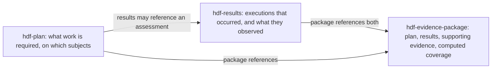

# ADR-0018: Linking plans, results and evidence packages — optional references, recorded executions, and plan coverage

**Date:** 2026-11-01 (first draft); revised 2026-11-02 after maintainer design review

**Status:** Proposed — design, not authorization to implement

**Decision owner:** Project maintainer

**Source baseline:** `3c252ba243ad779251d49c9c7b0435d9f8acfba7`; HDF source schemas identify v3.8.0

**Related work:** `hdf-libs-llsto` (the prompting epic), `hdf-libs-wgvm.29`, `hdf-libs-wgvm.31`; the OSPS converter exploration stays separate (`hdf-libs-wcene`).

**Consolidates:** the four draft documents of 2026-11-01 (decision, field catalog, research, examples). Three bodies of work from those drafts are carved out of this ADR and belong to their own decisions: a formal `hdf-threshold` document, plan deviations with their approval model, and the optional system-description (SSP) expansion. Appendix C lists what moved and why, so nothing in the research is lost.

Field names below are proposed API names, not current functionality.

## Context

An architect needs to say what assessment work a system requires, which subjects it covers, what evidence it must produce, and what makes the outcome acceptable. Today HDF has the right documents for this exchange but their relationships are too weak to carry it, and the weakness has been measured against the v3.8.0 source schemas:

- A plan assessment **requires** `baselineRef` and has no stable identity. The current `Assessment` definition's only required member is that reference. An assessment is therefore addressable only by its position or by a name string.
- A results document **cannot distinguish a completed clean scan from a scan that never ran.** `baselines` has no minimum length and every populated baseline requires a nonempty requirement list, so a clean run and an absent run are both `baselines: []`.
- **Completeness compares names.** The evidence builder de-duplicates plan baseline references and results baseline names, so one result document can stand in for every component that shares a benchmark. The prompting epic's motivating cases are the same golangci-lint baseline across module scopes and the same STIG applied to every host in a cluster.
- The package has three reference shapes already (`Content_Reference`, `External_Evidence_Reference`, and plain string locators such as `planRef`), none of which the other documents share.

The maintainer's framing for the revision, which this ADR adopts as its first principle:

> What we want is to be able to easily add references to other HDF doctypes within HDF docs. A results set *can* be associated with a system or a plan but does not have to be and is not by default. Separate CLI actions to associate a scan result with a plan or a system are fine; conversion does not need to be an all-in-one operation.

The first draft diagnosed the problem correctly but designed for the hardest cases and left the common path as heavy as the hard one: a six-field binding record that required a prior resolution step, an occurrence identifier that every one-shot plan had to mint, a per-subject reference carrying the owning document's digest, a ninth document family, and a forty-line example for one dependency scan. This revision keeps the diagnosis, the four-question model, and the verification matrix, and rebuilds the core around one rule: **the flow from plan to results to package must be writable in a dozen lines per document, and every link between documents is optional, explicit, and added on purpose.**

## Decision

### 1. Three documents, two arrows, every arrow optional



A results document is complete and valid with no plan and no system. A plan is complete with no results. A package is complete with results and no plan, in which case it carries no coverage claim. Coverage is a computed claim that exists only when a package pins a plan and the results that satisfy it.

### 2. One way to reference another HDF document

Introduce a single shared primitive, `Pinned_Reference`, in the common primitives:

| Field | Cardinality | Meaning |
| --- | --- | --- |
| `uri` | 1 | URI reference; a relative value resolves against the referring document. A location is not an identity and not an instruction to fetch. |
| `checksum` | 1 | Existing `Checksum` over the exact complete bytes. New computation defaults to `sha512` under the existing project decision; the schema stays algorithm-agnostic within `Hash_Algorithm`. |
| `documentId`, `version` | 0..1 | Logical identity and revision label when the target carries them. |
| `pointer` | 0..1 | JSON Pointer selecting a member after the whole document is verified. URI fragments are not permitted; the pointer is the sole member selector. |

The package's `Content_Reference` and `External_Evidence_Reference` become extensions of this primitive rather than siblings of it, keeping their own extra members (`type`, `componentRef`, `format`, `formatVersion`, `metadata`). The existing string locators `systemRef`, `planRef` and `baselineRef` remain valid as locators on every document that has them; evaluation uses pinned references and treats a bare string as "named, not pinned".

A digest proves byte equality. It does not prove authorization, and nothing in this ADR says otherwise.

### 3. Association is a separate, explicit act

Converters produce **unassociated** results. They record what ran and what was observed; they do not know the plan. Associating a result with a plan or a system is a later step performed by a dedicated command on an existing document, proposed as:

```
hdf results bind --plan plan.json --assessment <assessmentId> results.json
hdf results bind --system system.json results.json
```

The command computes the pinned reference, writes it into the result's execution record (or its root `systemRef` equivalent), and refuses when the target assessment does not exist in the pinned plan or when the subjects do not resolve against the pinned system. The verb and its placement are a decision point below; the contract is what matters: conversion and association are two operations, and the second is optional.

### 4. Plan: identified assessments with explicit subjects; the baseline is optional

Retain `assessments[]`. Each entry gains identity and explicit scope; `baselineRef` stops being required.

| Field | Cardinality | Meaning |
| --- | --- | --- |
| `assessmentId` | 1 | UUID. The stable obligation identity that results and coverage refer to. |
| `title` | 1 | Human label. |
| `subjects` XOR `selector` | 1 | `subjects` is a list of `componentId` values resolved against the plan's pinned `system`; `selector` is the existing label-map `Target_Selector` (all pairs must match). One inclusion mechanism per assessment. |
| `mode` | 0..1, default `individual` | `individual` requires each subject independently; `collective` requires one assessment over exactly the set. Neither implies the other. |
| `baseline` | 0..1 | `Pinned_Reference` to a genuine requirement baseline, with an optional `selection` of requirement ids. Absent for discovery-style assessments such as dependency scans, which have no requirement list before the scan runs. |
| `thresholds` | 0..n | `Pinned_Reference` values to threshold files in the **existing** threshold file format. All apply conjunctively. A formal threshold document is a separate ADR (Appendix C). |
| `requiredEvidence` | 0..n | `{kind, count}` where kind is `nativeReport`, `hdfResults`, `bom`, `document`, `review`. Enough to say "a native report must be present"; richer format and reviewer rules are later work. |
| `completionRequired` | 0..1, default `true` | Whether a missing execution fails coverage. |
| Existing `componentRef`, `targetSelector`, `runner`, `inputs`, `description` | retained | `componentRef` and `targetSelector` are superseded by `subjects`/`selector` for new plans and remain readable; `runner` and `inputs` are unchanged. |

Root: `system` becomes a `Pinned_Reference` (legacy `systemRef` remains a locator). Timing stays out of the core; when a plan declares no timing, each assessment has exactly one occurrence, identified by the plan's own digest, so no plan has to mint an occurrence to be evaluable.

Purpose, method and mode taxonomies (vulnerability assessment versus SAST, examine versus test, automated versus manual) are kept out of the core. They matter for OSCAL interchange and for programs that require them, and they are catalogued in Appendix C for the follow-on ADRs.

The minimal plan this ADR must be able to express, in the shape proposed here:

```json
{
  "name": "hdf-libs CI",
  "system": {"uri": "system.json", "checksum": {"algorithm": "sha512", "value": "<system bytes>"}},
  "assessments": [
    {
      "assessmentId": "11111111-1111-4111-8111-111111111111",
      "title": "Dependency vulnerability scan",
      "subjects": ["22222222-2222-4222-8222-222222222222"],
      "thresholds": [{"uri": "policies/deps.yaml", "checksum": {"algorithm": "sha512", "value": "<policy bytes>"}}]
    }
  ]
}
```

This excerpt is a design illustration and is not claimed to pass an implemented schema. If the implementation cannot keep this case this small, the design has failed its own test and must be simplified before cards are cut.

### 5. Results: executions record that work happened, including clean and failed runs

Add `executions[]` at the results root. Everything in this section is **additive**; results is the most-consumed HDF schema and this ADR adds no required member to it.

| Field | Cardinality | Meaning |
| --- | --- | --- |
| `executionId` | 1 | UUID for one actual attempt, never reused for different content. |
| `status` | 1 | `completed`, `partial`, `failed`, `cancelled`, `unknown`. Operational outcome, distinct from any requirement status. |
| `startedAt`, `endedAt` | 1 each for a terminal status | Source timestamps. Import time is not execution time. |
| `subjects` | 0..n | `componentId` values actually assessed. Per-subject outcomes keep a fleet job from hiding one unreachable host. |
| `subjectOutcomes` | 0..n | `{componentId, status, limitations[]}` when subjects differ in outcome. |
| `assessmentRef` | 0..1 | `{plan: Pinned_Reference, assessmentId}`. **This is the common-path join.** Written by `hdf results bind`, or by a producer that genuinely knows the plan. |
| `baselineGroups` | 0..n | `groupId` values of the evaluated baselines this execution produced, when the document carries more than one execution. |
| `tool`, `runner`, `configuration` | 0..1 | Existing `Tool`/`Runner` types and an optional pinned configuration reference. |
| `limitations` | 0..n | `{code, detail}`: authentication failure, unreachable target, unsupported language, truncation, timeout, conversion loss. No silent full-scope credit. |
| `artifacts` | 0..n | `{reference: Pinned_Reference, role}` for native reports and inputs. An execution never references its own containing results file. |

A completed execution with `baselines: []` is the legitimate shape of a clean discovery scan when the native report or the recorder establishes completion. The empty array alone establishes nothing; the execution record does.

Each `Evaluated_Baseline` gains an optional `groupId` (UUID) so an execution can name the groups it produced, and an optional `definition` (`Pinned_Reference`) when a real requirement baseline exists. The baseline `name` remains display text.

The minimal execution:

```json
{
  "executionId": "33333333-3333-4333-8333-333333333333",
  "status": "completed",
  "startedAt": "2026-11-01T10:00:00Z",
  "endedAt": "2026-11-01T10:02:11Z",
  "subjects": ["22222222-2222-4222-8222-222222222222"],
  "assessmentRef": {"plan": {"uri": "plan.json", "checksum": {"algorithm": "sha512", "value": "<plan bytes>"}}, "assessmentId": "11111111-1111-4111-8111-111111111111"}
}
```

**Late binding is the exception path.** When an unplanned run must later be attached to a plan, a separate results document may carry `baselines: []` and a root `assessmentBindings[]`, each entry pointing at an execution in another pinned results document and at whole baseline groups by pointer. The original document is never modified. A binding must cover the complete applicable population of groups; selecting only favorable groups is invalid. This path exists so that signed source evidence stays immutable; it is not how CI attaches results to a plan.

**Partition before roll-up, scoped.** ADR-0017 §6 rolls up one requirement per id within one baseline and merges impact and tags first-wins or worst-wins. That is lossless only while a baseline holds one subject's observations. When one results document carries several executions or several subjects, converters must emit one evaluated baseline per execution and subject before roll-up; filtering occurrences afterwards cannot recover subject-specific metadata that was already merged. This rule changes nothing for a document with one execution and one subject, which is every converter's output today. The epic implementing ADR-0017's roll-up (`hdf-libs-by8gn`) is in flight; its multi-subject converters must be measured for this partition before this ADR's cards are cut, and ADR-0017 is refined by reference here, not edited.

### 6. Evidence package: pin the inputs, compute coverage, hash acyclically

| Field | Proposed | Meaning |
| --- | --- | --- |
| `plan`, `system` | `Pinned_Reference` 0..1 each | The exact evaluation inputs. Legacy `planRef`/`systemRef` strings remain as locators. |
| `contents[]` | existing, extended from `Pinned_Reference` | Each entry gains an optional `entryId` so repeated URIs are addressable; hash-identical artifacts are aliases, not extra work. |
| `coverage` | `Plan_Coverage` 0..1 | Computed when `plan` is pinned; **omitted** otherwise, consistent with `hdf-libs-wgvm.31`. Never accepted as a cached boolean; `hdf evidence verify` recomputes it. |
| `completenessCheck` | retained as legacy | Keeps its current best-effort meaning on documents that carry it; not emitted alongside `coverage`. |

`Plan_Coverage` holds `evaluatedAt`, evaluator and semantics versions, the pinned plan and system, an `inputManifest` reference, and one row per `(assessmentId, subject or collective set, occurrence)` with separate outcomes for execution, evidence, findings and limitations, plus a summary and an overall decision of `satisfied`, `unsatisfied` or `indeterminate`. Rows are the truth; the summary is derived from them and duplicates cannot increase coverage.

The **input manifest** is a separate immutable artifact listing only the evaluator's inputs and their digests: plan, system, threshold files, results, native evidence, amendments. It excludes the containing package and the coverage report, so nothing hashes itself. Its digest is computed before the report; a detached checksum or signature can then cover the finished package. A package cannot authorize its own signer; trust configuration is the verifier's, supplied from outside the package.

The minimal package:

```json
{
  "name": "hdf-libs CI, 2026-11-01",
  "plan": {"uri": "plan.json", "checksum": {"algorithm": "sha512", "value": "<plan bytes>"}},
  "contents": [
    {"type": "hdf-plan", "uri": "plan.json", "checksum": {"algorithm": "sha512", "value": "<plan bytes>"}},
    {"type": "hdf-results", "uri": "deps.hdf.json", "checksum": {"algorithm": "sha512", "value": "<results bytes>"}}
  ]
}
```

`hdf evidence build` adds `coverage` to this when it can resolve the plan; `hdf evidence verify` recomputes and compares.

### 7. Four questions, kept separate

| Question | Meaning | Example |
| --- | --- | --- |
| Execution and scope | Did the required work occur over the required subjects? | The dependency scan completed against the intended commit. |
| Evidence sufficiency | Are the required outputs present and readable? | The native report is in the package and matches the execution's artifact digest. |
| Findings acceptance | Do the observations satisfy the pinned thresholds? | No unadjudicated high or critical findings. |
| Assurance and deviations | What integrity and authority claims were verified, and what departures were authorized? | Out of scope for this ADR's first milestone except byte integrity; see Appendix C. |

Completed work can have unacceptable findings. A report can contain no failures because the scanner never ran. Keep these distinct in the machine-readable report and in every UI.

### 8. Strictness is a verifier mode, not a schema profile

The first draft used "required in the strict profile" throughout without saying how a profile is expressed. JSON Schema cannot express required-under-a-profile without a second schema set or conditionals, and this repository's Go validator does not implement all of 2020-12. This ADR therefore makes **one** permissive schema per document and puts strictness in the evaluator: `hdf evidence verify --plan` reports, per row, what it could and could not establish. A missing execution is `unsatisfied`; a subject with no `componentId` is `indeterminate` with a reason; a bare string `planRef` where a pinned `plan` was expected is a named-not-pinned limitation. Nothing is silently passed, and nothing is made schema-invalid merely because a producer did not know the plan.

### 9. Compatibility and prior decisions

Treat adoption as a versioned schema change under the project's release policy: any schema change is at least a minor. Plan is rewritten and the rewrite is breaking for existing plan documents, which today exist as repository fixtures and the plan being packaged under `hdf-libs-wgvm.29`; that card must either land on the current shape and migrate, or wait. Results, package and common primitives change additively. Amendments do not change in this ADR.

Historical documents remain valid under their historical schemas and stronger evaluation requires new facts; migration cannot infer execution success or subject scope from missing data.

| Existing decision | Relationship |
| --- | --- |
| ADR-0001 BOM | Reuse `boms[]`; a BOM obligation is an evidence requirement, not a new field. |
| ADR-0003 / ADR-0005 streaming | A reconciled snapshot's timestamp is not fresh execution evidence; event replay must keep execution references resolvable or be marked posture-only. |
| ADR-0010 / ADR-0012 data platform | HDF owns the exchange shapes and the evaluation kernel; the sibling platform owns storage projections. Coordinate adoption separately. |
| ADR-0014 OSCAL | Native AP/AR export of a baseline-free plan must report a fidelity limit, never invent a control. The corrected mappings belong to that ADR's lineage (Appendix C). |
| ADR-0016 merge | A read-time union is a view; it is ineligible as execution evidence unless it preserves source context. |
| ADR-0017 roll-up | Refined by §5 above for multi-execution documents only. |

## Alternatives considered

### Alternative A: Optional baseline plus pinned thresholds only

**Pros:** small change, immediate authoring benefit. **Cons:** no execution record, so a missing scan and a clean scan stay indistinguishable. **Why rejected:** it cannot substantiate coverage, which is the epic's whole ask.

### Alternative B: The first draft's full model

Separate root bindings for every association, resolved-scope snapshots before binding, per-subject owner digests, a ninth document type, deviations inside amendments, and the SSP expansion in the same decision. **Pros:** every hard case is expressible on day one. **Cons:** the common case needs a prior resolution step and a forty-line plan entry; three overlapping reference shapes; thresholds and deviations decided on opposite principles; "strict profile" undefined. **Why rejected:** it fails the maintainer's simplicity test. Its hard-case machinery is retained where it costs nothing on the common path (late binding, input manifest) and deferred where it does not (Appendix C).

### Alternative C: Generate a baseline from each scan

**Why rejected:** the expected set would change with the findings and could never detect a missing scan.

### Alternative D: Require OSCAL AP/AR directly

**Why rejected:** mandatory control context; baseline-free work needs adaptation. Keep import and export.

### Alternative E: New execution and evaluation document families

**Why rejected now:** embedded executions and a reusable coverage definition suffice; revisit on a demonstrated independent lifecycle.

### Alternative F: Make conversion associate results with the plan in one step

**Why rejected:** the maintainer explicitly prefers association as a separate action, and a converter rarely knows the plan. One operation would also force every converter to learn pinned references.

### Alternative G: Do nothing

**Why rejected:** packages remain collections with name-matched coverage claims.

## Consequences

**Easier:** a plan, a result and a package can each be written small and linked on purpose. Omissions, failed tools, stale evidence and clean scans become distinguishable. Software and infrastructure assessments share one coverage model.

**Harder:** producers that want coverage credit must identify subjects by `componentId` and record executions; some scanner reports cannot establish completion without a recorder. Historical data cannot gain that precision retroactively.

**Risks and mitigations:** mixing subject contexts before roll-up misapplies severity or waivers, so partition first and mark ambiguous legacy groups indeterminate. Two reference mechanisms per document invite drift, so evaluation reads only the pinned form and reports a bare string as a limitation. The schema rewrite of plan is breaking, so sequence it against `hdf-libs-wgvm.29` explicitly.

## Implementation plan

### Scope

**In:** `Pinned_Reference` and the two package references extending it; plan assessment identity, subjects and optional baseline; results executions, group ids and late-binding records; package pinned inputs, coverage rows and input manifest; the `bind` command; Go and TypeScript evaluation parity; CLI, MCP, OpenAPI and schema-generation propagation.

**Out:** the formal threshold document; plan deviations and any approval or trust model; the SSP expansion of `hdf-system`; OSCAL export fidelity corrections; purpose/method/mode taxonomies; sampling; scheduling; new event streams.

### Quality standards and shared abstractions

- Author JSON Schema first, then generate TypeScript and Go types, bundled and embedded schemas and OpenAPI. Prove both validators enforce the intended constraints.
- One reference primitive, one subject identity (`componentId`), one coverage row type, shared by Go and TypeScript and pinned by fixed-time golden vectors both suites read.
- Semantic validation beyond schema: unique `assessmentId` and `executionId` within a document, `assessmentRef` resolving to an assessment in the pinned plan, subjects resolving in the pinned system, no self-referencing artifact.
- Bounded local resolution: no implicit network fetching; hash and evaluate the same bytes.
- Fixtures are real or schema-confirmed under the repository's fixture rules; the JSON in this ADR is illustration.

### Phase A — contract and spike

**Files:** `hdf-schema/src/schemas/primitives/common.schema.json` (`Pinned_Reference`), `plan.schema.json`, `result.schema.json`, `hdf-plan.schema.json`, `hdf-results.schema.json`, `hdf-evidence-package.schema.json`; generators, schema tests, embedded validators.

**Acceptance:** the three minimal examples in §§4–6 validate; a plan with no baseline, a results document with one completed execution and `baselines: []`, and a package with no plan all validate; generated types preserve cardinality; historical fixtures still validate against their historical versions. Before cards are cut, a throwaway spike proves the reference primitive and the execution shape generate correctly in both languages.

### Phase B — evaluation kernel

**Files:** `hdf-engine/src/evidence.ts`, `hdf-engine/go/evidence.go`, shared vectors under `hdf-engine/testdata/`.

**Acceptance:** expected rows materialize from a pinned plan and system as `(assessmentId, subject, occurrence)`; executions match rows by `assessmentRef` and subject; a missing subject stays missing when its sibling is covered; the existing threshold engine is called unchanged per row; one captured clock; Go and TypeScript agree on the vectors.

### Phase C — producers and the bind command

**Files:** `hdf-converters/shared/{typescript,go}/converterutil.*` and `rollup.*`; one discovery converter and one baseline converter as proving pairs; `hdf-cli/cmd/hdf/cmd/results_bind.go` (name per decision point); `plan_create.go`, `plan_set.go`.

**Acceptance:** the two converters emit an execution record with status and subjects and no plan knowledge; `bind` writes a resolvable `assessmentRef` and refuses an unknown assessment or unresolvable subject; a multi-subject converter from `hdf-libs-by8gn` partitions per subject before roll-up; a zero-findings scan produces a completed execution with `baselines: []`.

### Phase D — package evaluation

**Files:** `hdf-cli/cmd/hdf/cmd/evidence_{build,verify,bundle}.go`, `hdf-cli/internal/evidenceref/`, matching MCP tools.

**Acceptance:** a package without a plan carries no `coverage`; with a plan, rows report missing, partial and wrong-revision work; two hosts sharing a baseline stay separate; input manifest and report are acyclic; `verify` recomputes rather than trusting stored coverage.

### Phase E — consumers and repository adoption

**Files:** merge, diff and event consumers in `hdf-engine` and `hdf-diff`; CLI and MCP surfaces; the evidence-package and specification guides; the repository's own plan under `hdf-libs-wgvm.29`.

**Acceptance:** unions and reconciled snapshots cannot masquerade as executions; the repository's CI produces unassociated results, binds them to its plan, and builds a package whose coverage detects an intentionally omitted job.

### Verification matrix

These cases are the first failing tests of the child cards. They are retained from the first draft where they apply to the core.

| Case | Required invariant |
| --- | --- |
| No plan | No `coverage`; package inspection remains valid. |
| Requested plan unresolvable | Evaluation is `indeterminate`, never `satisfied`. |
| Completed scan, zero findings | Execution `completed`, `baselines: []`, threshold satisfied, row satisfied. |
| Empty report, no completion evidence | Execution `unknown` or absent; row `indeterminate`. |
| Timed-out tool, zero findings | Execution `failed` or `partial`; row unsatisfied; empty findings do not repair execution. |
| Scan of the previous commit | Wrong revision when a subject revision is pinned; otherwise a named-not-pinned limitation. |
| Same baseline on hosts A and B, results only for A | A satisfied, B missing. The baseline name covers neither. |
| One repository component, several module jobs | Each declared subject or group is its own row; a Linux report does not cover a Windows row. |
| A result bound to an assessment the plan does not contain | `bind` refuses; a hand-edited reference is a semantic error. |
| Late binding selects favorable groups only | Population closure fails. |
| Duplicate artifacts or paths | Aliases do not increase coverage. |
| Stored `coverage` disagrees with recomputation | `verify` reports the disagreement and uses its own result. |
| Report references the manifest that lists it | Rejected as a cycle. |
| Multi-subject document rolled up before partition | Per-subject acceptance `indeterminate`; no reverse projection of merged metadata. |

Metamorphic checks: reordering inputs or adding aliases does not change a decision; adding required scope cannot improve coverage.

### Reviewer challenge points and dispositions

| Challenge | Disposition |
| --- | --- |
| A. Does findings presence prove execution? | No. Execution records are independent evidence; zero-findings runs are valid only with a completed execution. |
| B. Can rolled-up metadata contaminate another subject? | Partition per execution and subject before roll-up for multi-subject documents; legacy single-subject documents unchanged. |
| C. Can a later binding modify source evidence or cherry-pick? | Late binding is a separate document pointing at whole groups; the original is immutable. |
| D. Can report digests refer to themselves? | Separate input manifest; detached final signature. |
| E. Do baseline-free exports invent OSCAL controls? | Moved to the ADR-0014 lineage; this ADR requires only that export report a limitation. |
| F. Can a legacy waiver target the wrong repeated requirement? | Moved to the deviations and amendments follow-on; strict evaluation treats an ambiguous target as `indeterminate` meanwhile. |
| G. Is the common path as small as claimed? | Measured by the three examples in §§4–6; Phase A fails if they grow. |
| H. Are thresholds and deviations decided on one principle? | Both carved out to their own ADR; neither changes a root schema here. |

"Disposition" states a coherent contract; the executable spike and maintainer review may still revise it.

### Decisions requiring maintainer review

1. Approve the core shape: optional pinned references, execution records with an optional `assessmentRef`, computed package coverage.
2. Name and placement of the association command: `hdf results bind`, or a `--plan`/`--system` option on an existing command.
3. Whether `subjects` may name a component by label when the pinned system assigns no `componentId`, with a named-not-pinned limitation, or whether a UUID is required for any coverage credit.
4. Sequencing against `hdf-libs-wgvm.29` (plan shape) and `hdf-libs-by8gn` (roll-up partition).
5. Release and migration strategy for the plan rewrite.

No implementation, epic decomposition, commit or push is authorized by this draft.

## Appendix A — standards pins

OSCAL `v1.2.3` resolves through annotated tag `a504f40be661d4c1758e753643b0164978a9c2f1` to commit `e061961c7702afeabffdf5e59894d35e748dade1`. Release schema SHA-256 digests, inspected directly:

| Release artifact | SHA-256 |
| --- | --- |
| Assessment Plan schema | `ea687b9d0ab1d84c9cb11ee0a5e22b17956fe892ee93f5acca937bef81d23ea2` |
| Assessment Results schema | `4034e2032332dbf597e59e0646ec16c2c31df992962490371e91f47b219ff42c` |
| System Security Plan schema | `99b1bee2df5604a7d4f1faeab43148e0bd4c4a1f513cd0d2d0c7896aa216a1e7` |

What they establish, as it bears on this ADR: an AP requires an imported SSP and a nonempty reviewed-control selection; an AR requires an imported AP and nonempty results, each with its own control selection and start time, while findings and observations are optional, so a findings-free AR result is legitimate. A baseline-free HDF plan is broader on this axis than either, which is why native export must report a limit rather than invent a control.

NIST SP 800-53A Rev. 5 (January 2022; release 5.2.0 content August 2025) distinguishes methods (examine, interview, test) from depth and coverage, and requires a sample to preserve its population, selected members and limits of inference. These taxonomies are deferred to the follow-on ADRs; the sampling rule informs §4's `mode`.

SARIF 2.1.0 separates invocation success from findings and distinguishes null results from an empty array, which is the model for §5's `status` being independent of `baselines`. in-toto Statement v1 (attestation v1.2.0, commit `df02077bf97218a8860a5c534eff1f1381f56984`), DSSE v1.0.2 (commit `1d14ad6f941e31670a9ee42d64afd8ce1572bc37`) and SLSA v1.2 build provenance inform the separation of byte integrity, signature validity and authority; this ADR adopts none of them.

## Appendix B — current implementation findings

Source-audit conclusions at the baseline, verified against the v3.8.0 source schemas during the revision:

- Plan `Assessment` has `required: ["baselineRef"]`, `unevaluatedProperties: false`, and no identity field.
- Results `baselines` has no `minItems`; `Evaluated_Baseline` requires `name` and a nonempty `requirements`.
- `Base_Component.componentId` is optional in the schema and "required in hdf-system documents" only by description text.
- The package carries `Content_Reference` (type, uri, checksum, componentRef) and `External_Evidence_Reference` (uri, format, checksum, mediaType, formatVersion, metadata) as unrelated definitions.
- Amendments require a nonempty `overrides`; this ADR leaves that unchanged.
- The SAP and SAR importers derive `baselineRef` from SSP hrefs or fallback strings and skip findings-free results, so log-only assessments have no normalized home today. The SAR exporter falls back to an `import-ap` href of `#`. These are corrected in the ADR-0014 lineage, not here.
- The evidence builder labels completeness a best-effort courtesy metric and compares baseline names globally; the engine's completeness compares planned baseline strings with covered names.

## Appendix C — carved out of this ADR, and where it goes

| Topic | From the first draft | Destination | Why not here |
| --- | --- | --- | --- |
| Formal `hdf-threshold` document | Ninth root with `thresholdId`, `semantics` version, wrapped policy, codec notes | A dedicated threshold ADR | The maintainer's call. Milestone one pins the existing threshold file by checksum, which already gives revision identity; a document adds identity and semantics versioning once a need is shown. |
| Plan deviations (`obligationExceptions`) | Kinds omit/substitute/defer/extend/accept-violation, approval claims, revocation, the amendments root changed to `anyOf` | Same ADR as thresholds | A deviation needs an approval model and changes the amendments root contract. Definition retained in this ADR's opening answer: a deviation is an authorized departure from the plan; an amendment reinterprets a finding; a deviation never touches requirement status. |
| Trust profiles, `Approval_Claim`, `Responsibility`, attempt selection, dependency graph with timing | Field catalog "Scope and responsibilities" and plan `dependsOn`, `attemptSelection` | The threshold and deviations ADR | They are the assurance quadrant of the four questions; the core proves the other three first. |
| Optional SSP expansion of `hdf-system` | Seventeen fields: identifiers, operational status, information types, security impact, architecture, parties, roles, locations, users, inventory items, implementation objects, services, data-flow state, requirement sources, control implementations, implementation relationships, leveraged authorizations | A separate system-description ADR | Orthogonal to the plan-to-package flow; large review surface. |
| OSCAL AP/AR/SSP mapping corrections and export fidelity limits | Research crosswalk and importer findings | ADR-0014 lineage | Interchange, not the core flow. |
| Purpose, method and mode taxonomies; rigor; `Requirement_Reference` with statement and objective ids; `assessmentObjectives` on baselines | Plan assessment taxonomy and baseline additions | Follow-on to this ADR once the core ships | Needed for OSCAL fidelity and some programs; not needed to express the flow. |
| Sampling, selectors beyond label matching, `Subject_Reference` with per-subject owner and discriminated revision | Field catalog "References" and "Scope" | Follow-on | The core resolves subjects against the plan's one pinned system; per-subject revision pinning is a later refinement. |
| Review observations without a baseline | Results `reviewObservations[]` | Follow-on | Manual assessments are in the core only as executions with a `document` or `review` evidence requirement. |

The first draft's complete text is preserved in the repository's gitignored scratch area for the revision session and in the design discussion that produced this ADR; nothing listed above is lost, it is sequenced.
